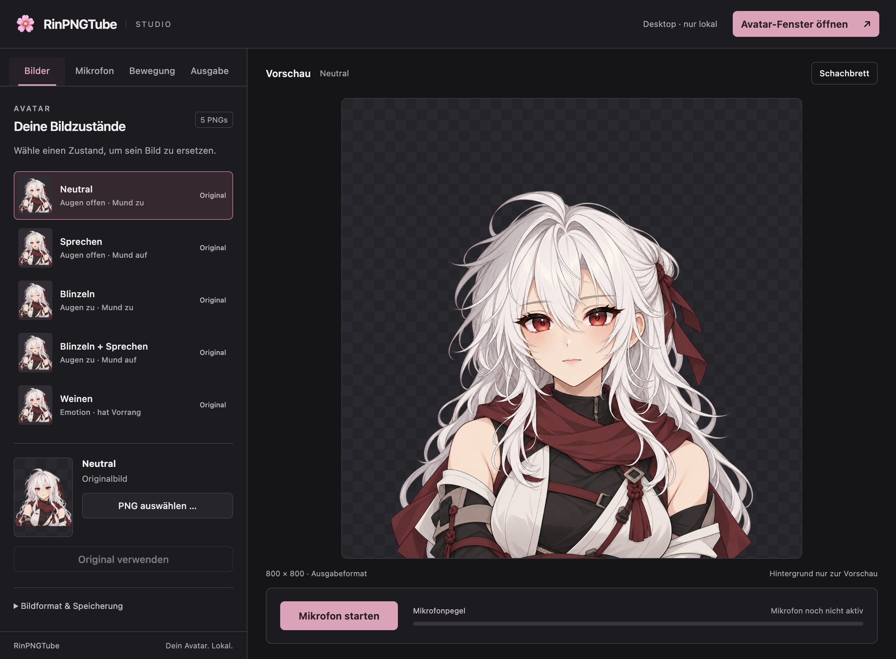

# RinPNGTube 1.2.0

Ein lokales PNGTuber-Studio für eigene Avatare: Mikrofon einschalten, Bildzustände zuordnen und den Avatar in einem transparenten Fenster oder als lokale OBS-Browserquelle anzeigen.



## Downloads

**[Alle Downloads für Version 1.2.0](https://github.com/foxtaex/rinpngtube/releases/tag/v1.2.0)** – fertige Programme, keine Node.js- oder Python-Installation nötig.

| System | Download |
| --- | --- |
| macOS, Apple Silicon (arm64) | [DMG](https://github.com/foxtaex/rinpngtube/releases/download/v1.2.0/RinPNGTube-1.2.0-mac-arm64.dmg) · [ZIP](https://github.com/foxtaex/rinpngtube/releases/download/v1.2.0/RinPNGTube-1.2.0-mac-arm64.zip) |
| Windows, x64 | [Installer](https://github.com/foxtaex/rinpngtube/releases/download/v1.2.0/RinPNGTube-1.2.0-win-x64.exe) · [Portable ZIP](https://github.com/foxtaex/rinpngtube/releases/download/v1.2.0/RinPNGTube-1.2.0-win-x64.zip) |
| Integrität | [SHA256SUMS](https://github.com/foxtaex/rinpngtube/releases/download/v1.2.0/SHA256SUMS) |

**Alle Pakete sind unsigniert; macOS ist nicht notarisiert. Windows wurde auf macOS crossgebaut und nicht unter Windows ausgeführt.** Kein Intel-Mac-Paket. GitHubs automatisch erzeugte „Source code“-Archive sind kein Ersatz für die oben verlinkten Programme.

## Funktionen

- Dunkles Studio mit großer Vorschau und Bereichen für Bilder, Mikrofon, Bewegung und Ausgabe.
- Fünf mitgelieferte PNG-Zustände: Neutral, Sprechen, Blinzeln, Blinzeln beim Sprechen und Weinen.
- Eigene PNGs je Zustand importieren, lokal speichern und einzeln auf das Original zurücksetzen. Maximal 12 MiB und 4096 × 4096 Pixel pro PNG.
- Lokale, pegelgesteuerte Mundanimation mit Hysterese, einstellbarer Schwelle und Haltezeit; keine Phonemerkennung.
- Automatisches Blinzeln, manuelle Emotion, Position, Skalierung und Spiegelung.
- Separates transparentes Avatarfenster und lokale OBS-Browserquelle; 800 × 800 Ausgabe.
- Kein Konto, kein Cloud-Upload und keine Audioaufnahme. Die Mikrofonanalyse bleibt lokal.

## Installation und erster Start

### macOS (Apple Silicon)

1. DMG öffnen und **RinPNGTube** nach **Programme** ziehen. Alternativ das ZIP entpacken und die App nach Programme verschieben.
2. App starten. Wegen der fehlenden Signierung kann macOS den Start blockieren. Nur bei vertrauenswürdigem Download nach einem Startversuch unter **Systemeinstellungen → Datenschutz & Sicherheit → Dennoch öffnen** bestätigen, sofern macOS diese Option anbietet. Keine systemweiten Sicherheitsfunktionen abschalten.
3. Im Studio **Mikrofon starten** wählen und die Mikrofonberechtigung erlauben. Bei einer Ablehnung unter **Datenschutz & Sicherheit → Mikrofon** freigeben, die App neu starten und das Mikrofon erneut aktivieren.

### Windows (x64, Laufzeit ungetestet)

1. Installer ausführen oder das portable ZIP vollständig in einen beschreibbaren Ordner entpacken und darin `RinPNGTube.exe` starten. Dateien im ZIP nicht einzeln verschieben.
2. SmartScreen kann wegen des unbekannten Herausgebers warnen. Quelle und Prüfsumme prüfen; nicht pauschal den Virenschutz deaktivieren.
3. In den Windows-Datenschutzeinstellungen den Mikrofonzugriff für Desktop-Apps erlauben, danach im Studio das Mikrofon starten.

### Avatar und OBS

Unter **Bilder** einen Zustand wählen und bei Bedarf ein eigenes PNG zuordnen. Unter **Mikrofon** den Eingang wählen und die Schwelle so einstellen, dass der Mund beim Sprechen öffnet und in Pausen schließt. Kleinere Schwellen reagieren empfindlicher.

**Avatar-Fenster öffnen** zeigt die separate Ausgabe. Für OBS unter **Ausgabe** den aktuellen Browserquellen-Link kopieren und als Browserquelle mit 800 × 800 Pixeln hinzufügen. App und OBS müssen auf demselben Rechner laufen; das Studio muss geöffnet bleiben. Der lokale Port kann sich nach einem Neustart ändern. Eine vollständige OBS-Aufnahme wurde nicht getestet.

Eigene Bilder und Einstellungen bleiben im lokalen App-Profil. Der interne Profilname `Rinraku Studio` und die App-ID `studio.rinraku.desktop` bleiben zur Kompatibilität erhalten. Das portable Windows-Paket speichert sein Profil ebenfalls im Benutzerprofil, nicht zwingend neben der EXE.

## Aus dem Quellcode bauen

Voraussetzungen: **Node.js 22 mit npm**. Im Repository-Verzeichnis:

```sh
npm ci
npm run build
npm test
npm start
```

Pakete erstellen:

```sh
npm run dist:mac  # macOS arm64, auf einem Mac bauen
npm run dist:win  # Windows x64; Crossbuild kann zusätzliche Plattformwerkzeuge benötigen
```

Ergebnisse liegen in `release/`. Electron 44.9.0 und electron-builder 26.15.3 sind im Manifest festgelegt; das Lockfile gehört zum Repository. Die erstmalige Installation und das Packaging benötigen Downloads der Abhängigkeiten und Buildwerkzeuge.

Das Repository ist eigenständig: `renderer/index.html` wird beim Build nach `app/index.html` kopiert. `app/studio.css`, `app/studio.mjs`, `app/microphone.mjs` und die fünf Dateien in `app/assets/` sind die Laufzeitquellen. Es werden weder ein ursprüngliches ZIP noch ein übergeordnetes Projekt benötigt. `desktop/` enthält Electron-Hauptprozess, isoliertes Preload und den ausschließlich an Loopback gebundenen lokalen Server.

### Prüfungen

`npm test` führt die Node-Tests aus. Native Integrationstests benötigen eine grafische Sitzung:

```sh
npm run test:native
npm run test:ui
npm run test:permissions
node tests/import.mjs
node tests/lipsync.mjs
```

Die Tests akzeptieren optional den Pfad zum gepackten Programm, beispielsweise `release/mac-arm64/RinPNGTube.app/Contents/MacOS/RinPNGTube`. Sie nutzen temporäre Testprofile; Berichte und Screenshots werden unter `verification/` erzeugt und nicht veröffentlicht. `scripts/verify-release.cjs` prüft lokal vorhandene Pakete gegen den Quellstand und die zuvor erzeugten Integrationsberichte; es setzt daher diese lokalen Prüfergebnisse voraus.

Für 1.2.0 wurden die gepackte Apple-Silicon-App, UI, PNG-Import/Persistenz, transparente Ausgabe, Mikrofon-Rechtepfade, Normalstart und pegelgesteuerte Mundanimation geprüft. Die Audio-Integration verwendet synthetische Signale; das ist keine individuelle Hardware-Sprachkalibrierung. **Windows-Runtime und OBS-End-to-End-Aufnahme sind nicht geprüft.**

## Lizenz und Artwork

Für dieses Projekt liegt derzeit keine ausdrückliche Softwarelizenz vor. Die öffentliche Bereitstellung ist keine pauschale Freigabe zur Weiterverwendung oder Weiterverteilung. Rechte an den mitgelieferten Charakterbildern und am daraus abgeleiteten Icon verbleiben bei den jeweiligen Rechteinhabern; es wird keine Artwork-Lizenz eingeräumt. Für weitergehende Nutzung bitte vorher die Rechte klären. Abhängigkeiten unterliegen ihren jeweiligen eigenen Lizenzen.